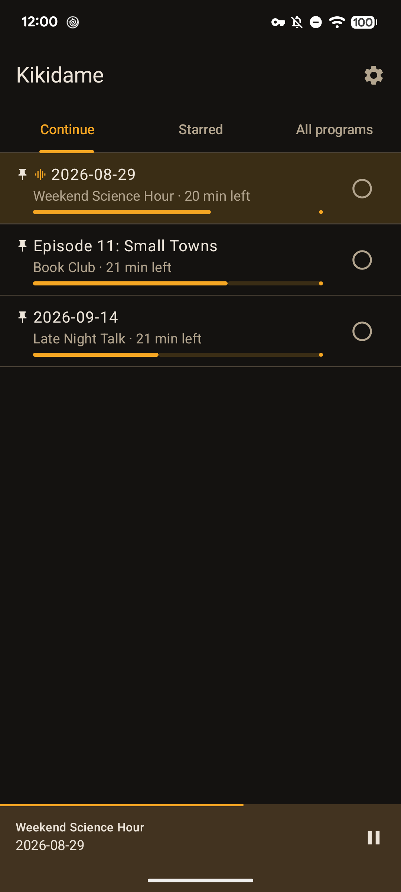
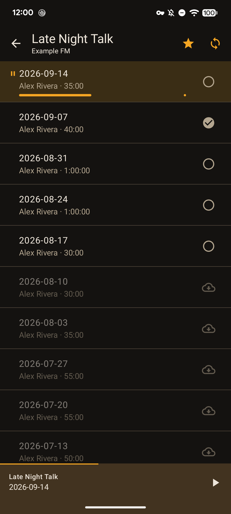
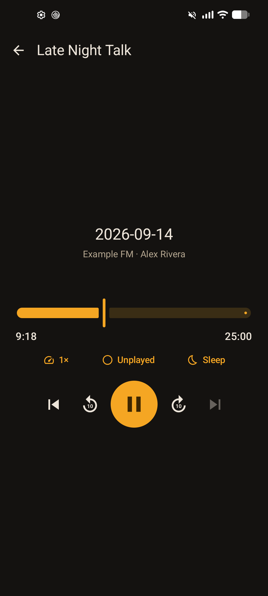
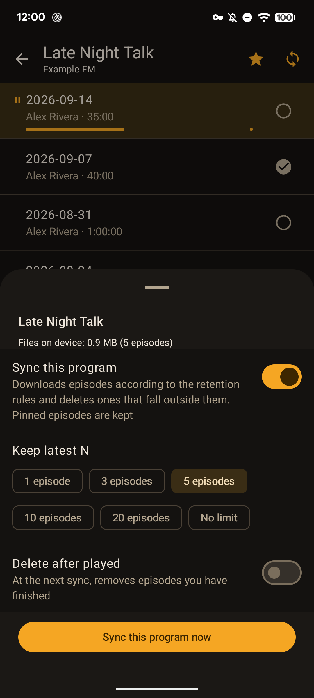
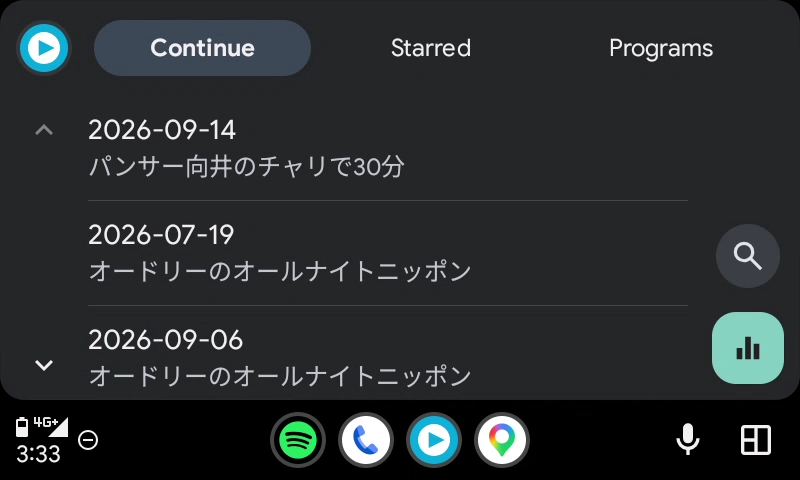

# Kikidame

English: [README.md](./README.md)

録り溜めた**ラジオ番組**を、Jellyfin サーバ・NAS の共有フォルダ・端末のフォルダのどれかに置いている人向けに、番組単位のルールで自動ダウンロード／削除し、取得元に到達できなくても聴けるようにする Android アプリ（ポッドキャストのファイルも使える）。Jellyfin プロジェクトとは無関係の非公式クライアントです。

https://github.com/user-attachments/assets/32c5be2d-5aee-4df7-baac-68106685913f

<p>
   
</p>
<p>

</p>

スクリーンショット: 続きから・各回一覧・再生画面・同期設定・Android Auto（英語 UI）

名前は「聴き溜め」から。録り溜めた回を、時間のあるときに手元で聴く、というアプリの用途そのものです。

## なぜ作ったか

既存の Jellyfin クライアント（公式アプリ・Findroid・Finamp）は映像か音楽が中心で、「番組単位で自動的に手元に置く／消す」と「サーバが落ちていても完全に成立する」が弱い。この 2 点だけを目的に、回が積み上がる音声の聴取に絞って作っている。

- **オフライン優先** — 聴くのは常に手元のファイル。再生位置・再生済みも手元で持つ。サーバに届かなくても再生は止まらない（Jellyfin のブックのライブラリでは、届くときにサーバと分け合う。下の「再生の共有」）
- **保持ルール** — 番組ごとに「最新 N 回まで保持」「再生済みなら削除」を決めると、あとは同期が不足分を落とし余剰分を消す

利用形態は、同時に 1 つの取得元（Jellyfin の 1 サーバ・1 ユーザー・1 ライブラリか、NAS の共有フォルダか端末のフォルダの 1 つ）。Jellyfin のブックのライブラリでは、再生位置と再生済みをサーバを通してほかの端末や Jellyfin Web と分け合う（**再生の共有**。下の「Jellyfin」の「再生の共有」）。それ以外の取得元（音楽ライブラリ・共有フォルダ・端末のフォルダ）では、再生位置と再生済みは手元だけで持ち、他端末や Web との併用は想定しない。取得元を変えると、手元の番組・各回・再生位置・ファイルをすべて消してやり直す。同じ Jellyfin のサーバとユーザーのまま、ライブラリだけを選び直すのは取得元を変えることに当たらず、手元は消さずに同期で結び直す（[ADR 0010](./docs/adr/0010-share-playback-state-via-jellyfin-book-library.md) の決定 7）。

## できること

- **番組一覧** — 「よく聴く」の印で節を分け、番組名・配信元名の検索と配信元での絞り込み。同期対象か、サーバから消えたか（消失）を行に出す。取得元に見つからない番組は、設定からまとめて手元から消せる
- **各回一覧** — ダウンロード／固定／再生済みの操作。手元にあるか、ダウンロード中か、失敗したかを行に出す
- **同期** — 番組ごとに同期対象と保持ルールを決める。3 時間ごとに WorkManager が同期し、「Wi-Fi のみ」を選べる。しばらく開いていないアプリの裏の同期は Android に遅らされることがあり、設定の「電池の最適化を外す」で外すと遅れにくくなる。裏で同期している間はトップバーの下に細いバーが出る。落とした後に取得元のファイルが書き換わったら（録音に後からチャプターが書き足されたときなど）、次の同期が新しいファイルを落として手元のファイルを差し替える。差し替え終えるまでは今のファイルで聴け、再生位置と再生済みは変わらない。聴いている回（プレイヤーに載っていて、聴き終えていない回）は、聴いている回でなくなった後の同期で差し替える。Jellyfin では、サーバがライブラリを走査し直してから書き換えに気づき、ファイルの大きさが変わらない書き換えには気づかない（[ADR 0011](./docs/adr/0011-replace-local-files-when-the-source-version-changes.md)）。同期の後のスナックバーには変化（新しい回・ダウンロード予約・削除）だけを出し、裏の同期は変化が無ければ何も出さない。設定の「最終同期」では、最後の同期の試みが失敗した・Wi-Fi ではないため見送ったことも見られる。裏の同期の失敗が 24 時間以上続くと、通知が 1 回出る（通知を許可しているとき）。手動でダウンロードした各回や、手元にある回をシートの「固定する」で固定した各回は「固定」になり、保持ルールでは消えない
- **再生** — バックグラウンド再生と通知・ロック画面の操作、±10 秒、倍速（1.0〜2.0）、スリープタイマー（時間指定／この回の終わりまで）、チャプターの一覧（ファイルに埋め込まれたチャプターへ移る）。再生位置を保存して次回は続きから、末尾近くまで聴くと自動で再生済み、聴き終えると同じ番組の次の回へ。アプリのプロセスが終わった後でも、Bluetooth ヘッドセットや車の ▶ ボタン（メディアボタン）、Android Auto から最後に聴いていた回を続きから再開できる。ただしメディアボタンは最後に音を鳴らしたアプリに届くので、ほかのアプリが最後に鳴っていれば、▶ ボタンはそちらに届く。アプリが閉じていても、ロック画面のメディアのコントロールに Kikidame のカードが残り、その ▶ で続きから聴ける。Bluetooth の接続だけでは自動で再生しない（[ADR 0008](./docs/adr/0008-no-autoplay-on-bluetooth-connect.md)）
- **Android Auto** — 車の画面で「続きから」「よく聴く」「番組」をたどって再生。手元にある回だけを出し、再生位置と再生済みはスマホと同じ規則で記録する（Auto はスマホ上で動くので同期は要らない）
- **ミニプレイヤー**・テーマの 3 択（システム／ダーク／ライト）
- **英語と日本語の UI** — OS の「アプリの言語」（Android 13 以上）で切り替え。既定は英語。他の言語を足すには `app/src/main/res/values-<lang>/strings.xml` を PR で（[docs/ui.md](./docs/ui.md) の「文言の足し方」）

用語（番組型の音声・番組・各回・配信元・公開日・出演者・固定・よく聴く・判断保留 など）は [CONTEXT.md](./CONTEXT.md) で定義している。

## 入れ方

Google Play では配布しない（[ADR 0005](./docs/adr/0005-open-source-distributed-outside-play.md)）。配布経路は 2 つ:

1. **GitHub Releases** の APK — [Releases](https://github.com/t-seki/kikidame/releases) から `kikidame-<版>.apk` を入れる
2. **Obtainium** — 自動更新したい人は [Obtainium](https://github.com/ImranR98/Obtainium) に `https://github.com/t-seki/kikidame` を登録する。新しい Release が出ると通知され、同じ署名の APK なので上書きで更新できる（手元の各回と再生位置は残る）

**IzzyOnDroid と F-Droid 本家には申請しない。** 理由は 2 つ。(1) どちらも生成 AI で書かれたコードを含むアプリを受け付けない方針で（[IzzyOnDroid の App Inclusion Policy](https://izzyondroid.org/docs/general/AppInclusionPolicy/): "We are strongly opposed to apps which are fully or in part created by generative AI tools"）、Kikidame のコードは大半を Claude Code で書いている。申請テンプレには AI 使用の申告が必須なので、正直に申告すれば却下対象になる。虚偽の申告はしない。(2) F-Droid 本家はソースからビルドし直して F-Droid の鍵で署名するため、Releases 版とは署名が違い、片方から片方へ更新できない（入れ直すと手元の各回と再生位置が消える）。F-Droid クライアントから入れたい人向けには、審査を通さない自前のリポジトリを検討している。

端末は Android 12（API 31）以上。ストア向けの説明文とスクリーンショットは [fastlane/metadata/android/](./fastlane/metadata/android/) にある（Obtainium は読まないが、自前の F-Droid リポジトリの `fdroidserver` がそのまま読む形式なので残している）。

## 取得元の前提

接続できるのは **Jellyfin**・**NAS の共有フォルダ（SMB）**・**端末のフォルダ** のどれか 1 つ。SMB の共有フォルダと端末のフォルダは v0.4.0 から選べる（v0.3.0 までの release 版は Jellyfin だけ）。

### Jellyfin

- Jellyfin **10.10 以上**を対象（10.10.7 / 12.0.0 はコンテナと統合テスト、10.11 は実機で確認。`scripts/jellyfin-testserver.sh` と `docs/development.md` の「テスト用 Jellyfin サーバ」を参照。レガシー認証は使わない）
- 音声は**ブックのライブラリ**（コンテンツの種類「ブック」）か**音楽ライブラリ**として取り込まれていること。勧めるのはブックのライブラリ。再生位置と再生済みを Jellyfin を通してほかの端末や Jellyfin Web と分け合う機能（再生の共有。下）は、ブックのライブラリでだけ行う（[ADR 0010](./docs/adr/0010-share-playback-state-via-jellyfin-book-library.md)）。音楽ライブラリも今までどおり使えるが、再生位置と再生済みは手元だけで持つ。アプリはこう読み替える:

  | Jellyfin（ブックのライブラリ） | Jellyfin（音楽ライブラリ） | アプリ内 |
  | --- | --- | --- |
  | 各回の Album のタグ | MusicAlbum | 番組 |
  | AudioBook | Audio | 各回 |
  | 各回の AlbumArtist のタグ | MusicAlbum の AlbumArtist | 配信元 |
  | AudioBook の Artists | Audio の Artists | 出演者（表示のみ） |
  | PremiereDate（無ければ DateCreated） | PremiereDate（無ければ DateCreated） | 公開日（並び順・「最新 N 回」の基準） |
  | 番組のフォルダの画像（各回が 1 本だけの番組には無い） | MusicAlbum の画像 | 番組の画像 |

- つまりファイルのタグが `album` = 番組、`albumartist` = 配信元、日付（M4A の `©day`）= 公開日、`artist` = 出演者 になっていればよい。ブックのライブラリでは、アプリが `album` と `albumartist` のタグで各回を番組にまとめ、音楽ライブラリでは Jellyfin が上の構造を組む。MP3 の日付タグで公開日が取れるかは未確認
  - ラジオ録音なら、`album` = 番組、`albumartist` = 放送局、日付（M4A の `©day`）= 放送日、のタグを Mp3tag などの汎用のタグ編集ツールで付ければよい
  - ポッドキャストなら、フィードから落としたファイルに `album` = 番組名、`albumartist` = 配信者やネットワーク、日付 = 配信日を付けてライブラリに置く。音楽ライブラリでは、番組ごとにフォルダを分けると Jellyfin が MusicAlbum にまとめやすい
  - ブックのライブラリは、10.10.7・12.0 のコンテナ（統合テスト）と 10.11.11 のコンテナで、各回が AudioBook として一覧に出ることを確かめた。本番のサーバでの移行はまだ確かめていない
- **再生の共有**（ブックのライブラリだけ。[ADR 0010](./docs/adr/0010-share-playback-state-via-jellyfin-book-library.md)）: 各回の再生位置と再生済みを、Jellyfin の UserData（各回の再生位置・再生済み・最後に再生した日時）に書き、ほかで書かれた値を取り込む
  - **Kikidame と Jellyfin Web などのほかのクライアントで、同じ Jellyfin のユーザーでログインする。** UserData は Jellyfin のユーザーと各回の組ごとにサーバの DB に置かれ（音声ファイルには書かれない）、別のユーザーで聴いた分は分け合えない
  - 送るのは、一時停止・停止・回の終わり・再生済みの手動切替のとき（再生していない間に切り替えた分は、再生を始めたときか次の同期で送る）。読むのは、同期のたびと、回を鳴らし始める直前（一時停止からの再開を含む。2 秒まで待ち、読めなければ手元の位置で鳴らす）。同期のとき、聴いている回は手元のまま
  - 両方で変わっていたら、新しい方を採る（手元で変えた時刻と、サーバの最後に再生した日時を比べる）
  - サーバに届かないときも手元の再生は止まらない。送れなかった分は次の同期で送る。設定の「最終同期」の下の「再生の共有」に、最後に共有できた時刻と、送れなかったことが出る（通知は出さない）
  - ほかで再生済みになった回も、同期で取り込んだ後は「再生済みなら削除」の対象になる
  - Jellyfin Web などは、サーバの規則で位置と再生済みを決める。10.11.11 のコンテナで再生の報告を送って確かめた範囲では、5 分未満で止めた位置は残らず、残り 5 分を切ると再生済みになる（サーバの設定 `MinAudiobookResume`・`MaxAudiobookResume`、既定 5 分）。Kikidame の再生済み（末尾から 2 分）とは閾値が違う。10.10・12 での Web の規則は未確認
  - Kikidame の再生は、Jellyfin のダッシュボードの「再生中」や再生回数には出ない（再生の報告は送らず、UserData に直接書くため）
  - 書き込みと読み戻しは 10.10.7・12.0.0 のコンテナで確かめた（統合テスト）。10.11 の本番での確かめと、Jellyfin Web の画面での見え方は未確認
  - サーバ側で各回のアイテムが作り直されたとき（ファイル名を変えたときなど）に、サーバの UserData が新しいアイテムに引き継がれるかは未確認。Kikidame の手元にある分は、同期で結び直した後に新しいアイテムへ書き直す
- 音楽ライブラリからブックのライブラリへ移る手順（手元の番組・各回・再生位置・再生済み・落としたファイルは、ライブラリを選び直した後の同期で、配信元・番組名・タイトルで突合して結び直す。[ADR 0001](./docs/adr/0001-local-surrogate-key.md)）:
  1. Kikidame を、ブックのライブラリを選べる版に上げる
  2. Jellyfin のダッシュボードで、音楽ライブラリを消す。同じフォルダを音楽とブックの 2 つのライブラリに入れると、アイテムが使い回され、ブックのライブラリでも Audio と MusicAlbum のまま見えるため（[ADR 0010](./docs/adr/0010-share-playback-state-via-jellyfin-book-library.md) の「確かめた事実」）
  3. 同じフォルダで、コンテンツの種類が「ブック」のライブラリを作り、スキャンが終わるのを待つ
  4. Kikidame の「設定」の「ライブラリ」をタップし、ブックのライブラリを選んで「決定」をタップする。同期が始まる
  5. 番組と各回がそのまま残っていること、聴きかけの回の位置と再生済みの印が残っていることを確かめる。結び直した各回の位置と再生済みは、同じ同期でサーバへ書く（サーバに別の値があれば、新しい方を採る）。結び直せなかった番組（配信元・番組名が変わったときなど）は手元に残り、設定の「取得元に見つからない番組を手元から消す」の数に入る

### NAS の共有フォルダ（SMB）

- SMB2/3 のみ（SMB1 は非対応）。ホスト（名前か IP アドレス）、共有名、共有の中のフォルダ（省略可）、ユーザー名とパスワードを入れる。ゲストとして接続することもできる。パスワードは暗号化して端末に保存する。アプリは共有を読むだけで、書き込みも削除もしない
- 共有（または入力したフォルダ）の中の構成は、ちょうど **`<配信元>/<番組>/<各回のファイル>`** の 3 段:

  | フォルダの段 | アプリ内 |
  | --- | --- |
  | 1 段目のフォルダ | 配信元 |
  | 2 段目のフォルダ | 番組（音声がまだ 1 本も無くても番組） |
  | 2 段目のフォルダの中の音声ファイル | 各回（拡張子で判定: m4a、mp3、aac、ogg、opus、flac、wav） |

  それ以外（音声でないファイル、ほかの段のファイル）は黙って無視する。名前が `.`・`@`・`#` で始まるフォルダとファイル（NAS や OS が作る `@eaDir`・`#recycle`・`._foo.m4a` など）は、どの段でも無視する。例外として、番組のフォルダ（2 段目のフォルダ）の `folder.jpg`（名前が完全に一致するものだけ）は番組の画像として読む
- 配信元と番組はフォルダの名前で決め、タグは使わない。各回はタグから読む: タイトル（無ければ拡張子を除いたファイル名）、日付（年月日まで無ければファイルの更新日時）、尺、artist（出演者）。タグを読み直すのは、ファイルのパス・サイズ・更新日時のどれかが変わったときだけ
- 最初の全走査は、先にフォルダの一覧を全部取り、番組ごとにタグを読む。タグを読み終えた番組から番組一覧に出る。タグを読んでいる間は、番組一覧に「タグを読み込み中 1,234 / 6,090」のように件数を出す。各回のファイルが数千本ある共有の最初の取り込みは、十数分かかる（ある NAS で約 6,000 本・約 12 分。NAS・ネットワーク・ファイルによって変わる）
- **最初の取り込みの間は、アプリを開いて画面をつけておく。** 画面が消えてアプリが裏に回ると、しばらくして（数秒〜数分。端末や状況で変わる）Android がアプリの通信を切り、取り込みは止まる。取り込み済みの番組は残り、次にアプリを開いたとき、読み終えていない番組から続きを読む（取り込み済みの番組のタグは読み直さない）。番組が共有から消えたかどうかは、最後まで読み終えた走査でだけ判断する
- 読み取りが失敗したら、接続を張り直して同じファイルから読み直し、続けて 3 回失敗したら、その同期は到達不能で終わる。張り直しで実際に続けられるか（短い通信の途切れの後など）は、実機ではまだ確かめていない
- 各回のファイル名を変えると未結合になり、同じ番組の中でタイトル（次に公開日と尺）で結び直す。番組のフォルダ名を変えると、配信元と番組名で結べないので、その番組は消失（判断保留）になる
- お使いの NAS とネットワークで動くか（名前の解決、ゲストの接続、最初の取り込みにかかる時間）は、1 台の NAS と 1 台の端末でしか確かめていない。試す準備は [docs/device-testing.md](./docs/device-testing.md) の「共有フォルダ（SMB）」を参照

### 端末のフォルダ

- 内部ストレージか SD カードのフォルダを、Android のフォルダ選択（Storage Access Framework）で選ぶ。ほかの provider（Google ドライブ、SAF 経由の SMB など）のフォルダは受け付けず、端末のフォルダを選び直してもらう。アプリはフォルダを読むだけで、書き込みも削除もしない。「ローカルネットワーク」の権限は要らない
- フォルダの中の構成は、上の SMB の共有フォルダと同じく、ちょうど **`<配信元>/<番組>/<各回のファイル>`** の 3 段。例えば `Radio/<配信元>/<番組>/<回>.m4a` なら `Radio` を選ぶ。内部ストレージの直下や `Download` そのものは Android の決まりで選べないので、その下にフォルダを作って選ぶ。`Download` の下のフォルダを選べるかは未確認
- ほかの取得元と同じく、各回はアプリの中にコピーしてから聴く。**コピーした回は、端末の容量を二重に使う**（フォルダのファイルと、アプリの中のコピー）。番組ごとの同期対象と保持ルールで、コピーする数を絞れる
- **フォルダのファイルは消さずに置いておく。** フォルダからファイルを消すと、次の同期でその回は取得元から消えたものとして扱われ、アプリの中のコピーも消える（固定していても消える）。PC で録ったファイルを Syncthing や FolderSync などでフォルダに同期して溜める使い方を想定しているので、ファイルはそのまま置いておく
- 端末のフォルダからのダウンロードと同期にはネットワークが要らないので、「Wi-Fi のみ」もかけない（端末の中から端末の中へのコピーなので）
- フォルダを読めなくなったら（権限が取り消された、フォルダを移した・消した）、ログアウトしてフォルダを選び直してもらう。手元の番組・各回・ファイルは残り、選び直したフォルダの中の構成が同じなら結び直る
- 内部ストレージのフォルダは実機（Android 17）で、取り込み・コピー・再生・フォルダを動かした後の選び直しまで確かめた。SD カードとファイルの多いフォルダで動くかは未確認。試す準備は [docs/device-testing.md](./docs/device-testing.md) の「端末のフォルダ」を参照

## 仕組みの要点

- **取得元（Jellyfin サーバか共有フォルダ）が各回の存在の正、手元はキャッシュ。** 同期の削除は、取得元の完全な一覧が取れたときにだけ行う（[ADR 0003](./docs/adr/0003-sync-deletes-only-from-full-listing.md)）。取れなければその番組は判断保留で、何も落とさず何も消さない
- **再生位置と再生済みは手元で持ち、Jellyfin のブックのライブラリでだけサーバと分け合う。** 各回ごとに「最後に見たサーバの値」を手元に持ち、サーバだけが変わればサーバの値を、手元だけが変われば手元を採る。両方が変わったときだけ時刻で比べる。音楽ライブラリと共有フォルダでは、サーバへ送らず、サーバの値も使わない（[ADR 0010](./docs/adr/0010-share-playback-state-via-jellyfin-book-library.md)）
- **アプリ内の同一性は取得元 ID（Jellyfin の id、共有フォルダでは中の相対パス）に依存しない。** サーバでライブラリを作り直して ID が変わっても、共有フォルダでファイル名を変えても、配信元・番組名・タイトルで突合して結び直し、ファイルも再生位置も残す（[ADR 0001](./docs/adr/0001-local-surrogate-key.md)）
- **保持ルールが効くのは同期のときだけ。** 再生済みにした瞬間には何も消えない。番組の同期の設定を変えている間も何も消えず、設定を閉じたときにその番組の同期が走って適用される

## ビルドと実行

JDK 25 と Android SDK（platform 37）が要る。リポジトリ直下に `local.properties`（git 管理外）を置く:

```
sdk.dir=/home/<you>/Android/Sdk
```

```bash
export JAVA_HOME=~/.local/jdk/current   # JDK 25
./gradlew test                          # ユニットテスト（エミュレータ不要、CI と同じ）
./gradlew :app:assembleDebug            # APK
./gradlew :app:installDebug             # 接続中の端末へ
```

ツールチェインの揃え方は [docs/development.md](./docs/development.md)、Linux や WSL2 から adb でつなぐワイヤレスデバッグと DB とファイルの突き合わせは [docs/device-testing.md](./docs/device-testing.md)。

## モジュール構成

```
:core:domain   純粋 Kotlin。番組／各回／保持ルール／再生済みの型と、同期・再生済み判定の純粋関数
:core:data     Room の Entity / DAO / Repository。Entity ↔ ドメイン型の変換はここに閉じる
:app           Compose UI、Media3 の MediaLibraryService（再生と Android Auto のブラウズツリー）、WorkManager の Worker、Hilt
```

スタックは Kotlin / Jetpack Compose (Material 3) / Media3 / Room / WorkManager / Hilt / jellyfin-sdk-kotlin。ダウンロードは Media3 の DownloadManager を使わず、SDK が作った URL とヘッダで OkHttp から直接ファイルへ書く（[ADR 0002](./docs/adr/0002-download-without-media3-downloadmanager.md)）。

## やらないこと

- 映像・トランスコード・キャスト
- 複数サーバ・複数ユーザー・複数ライブラリ
- Jellyfin のブックのライブラリのほか（音楽ライブラリ・共有フォルダ・端末のフォルダ）での、再生位置と再生済みの共有
- サーバ管理
- オーディオブック（古い章から順に聴くので「最新 N 回まで保持」が合わない。対応するなら番組に「向き」を足す設計が要る）
- Google Play での配布と課金（需要が見えたら Releases は無料のまま Play に有料版を併売する選択肢は残している。[ADR 0005](./docs/adr/0005-open-source-distributed-outside-play.md)）

全体は [docs/architecture.md](./docs/architecture.md) の「やらないこと」。

## ドキュメント

- 用語集: [CONTEXT.md](./CONTEXT.md)
- 設計判断の記録: [docs/adr/](./docs/adr/)
- 設計（全体像・モジュール・スキーマ・同期）: [docs/architecture.md](./docs/architecture.md)
- 開発ガイド（ツールチェイン・テスト・リリース）: [docs/development.md](./docs/development.md)
- 実機で試す手順（ワイヤレスデバッグ・Android Auto・試験用のデータの準備・DB とファイルの突き合わせ）: [docs/device-testing.md](./docs/device-testing.md)
- UI の方針（大事にすること・色・画面ごとの役割）: [docs/ui.md](./docs/ui.md)

## ライセンス

[MPL-2.0](./LICENSE)（[ADR 0005](./docs/adr/0005-open-source-distributed-outside-play.md)）。Kikidame は Jellyfin プロジェクトとは無関係の非公式クライアントで、Jellyfin の名前とロゴは Jellyfin プロジェクトのものです。

サーバとの通信には [jellyfin-sdk-kotlin](https://github.com/jellyfin/jellyfin-sdk-kotlin)（LGPL-3.0）を使っています。同梱している依存ライブラリとそのライセンスの一覧はアプリ内の「設定 > オープンソースライセンス」に出ます。一覧の元データは `app/src/main/res/raw/aboutlibraries.json` で、依存を変えたら `./gradlew :app:exportLibraryDefinitions` で再生成してコミットします（ビルド時には生成しないので、オフラインのビルドでも同じ一覧になります）。
